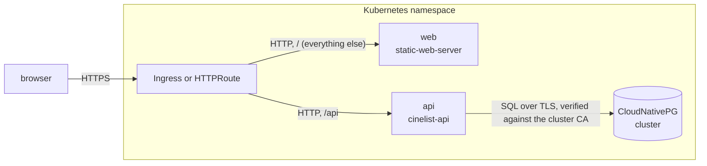
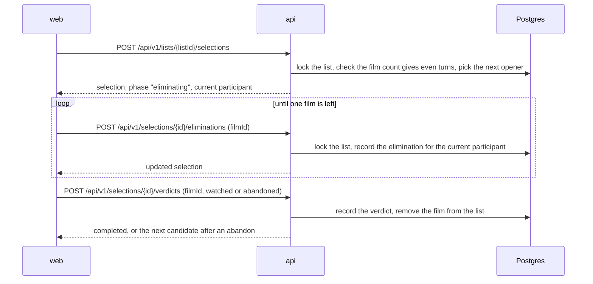
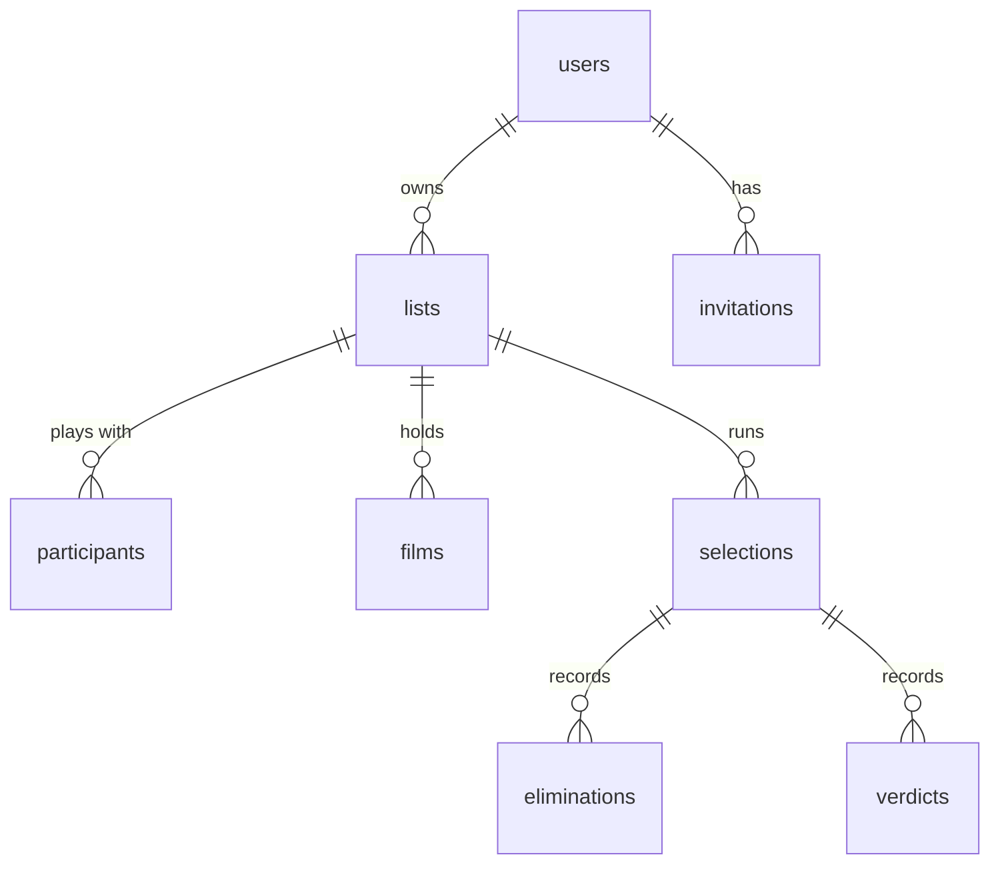

# Architecture

## Overview

CineList is two deployables sharing one origin: a Rust HTTP API that owns the
rules of the game and the database, and a React front compiled to static
files. A route sends `/api` to the API and everything else to the front
([ADR 0001](docs/adr/0001-split-cinelist-into-a-rust-api-and-a-static-web-front.md)).
The data lives in PostgreSQL, by default a CloudNativePG cluster created by
the Helm chart
([ADR 0002](docs/adr/0002-store-data-in-postgresql-managed-by-cloudnativepg.md)).

## Components

### `api/`

The HTTP API (`cinelist-api`, axum). It is the only component with logic and
the only one that talks to the database. It mounts every route under `/api`:
the product API under `/api/v1`, its OpenAPI document at `/api/openapi.json`
(generated from the code by `aide`) and the Scalar reference at `/api/docs`.
Liveness and readiness probes (`/healthz`, `/readyz`) sit outside the document
and outside `/api`, so the public route never exposes them.

- [`src/domain.rs`](api/src/domain.rs) holds the rules — when a selection can start, turn
  rotation, places, the phases of a selection, film statistics — as pure
  functions, independent of storage and HTTP.
- [`src/db/`](api/src/db) is the data access layer; each query is a `.sql`
  file under [`queries/`](api/queries), loaded at compile time.
- [`src/view.rs`](api/src/view.rs) assembles a list or a selection from its
  rows in a fixed number of batched queries.
- [`src/api/`](api/src/api) holds the handlers and their request and response
  types, one module per resource.

At startup it applies the migrations in [`migrations/`](api/migrations), then
creates or updates the administrator from its configuration.

### `web/`

The React single-page application. It has no server of its own: the image
serves the build output with `static-web-server`, falling back to
`index.html` for client-side routes. Every piece of data comes from the API,
through TanStack Query, and every response is validated with `zod` before use.
Translations live in [`web/src/i18n/`](web/src/i18n).

### `charts/cinelist/`

The Helm chart deploying both components, the CloudNativePG `Cluster`, and
either an Ingress or an HTTPRoute (or both).

## Data flow

### A selection

A selection runs on one device. The API decides whose turn it is from the
turn order and the number of eliminations already played; the client only
says which film goes.

The film under judgement is the survivor first, then — for each abandon — the
film eliminated last among the remaining ones. The selection completes on the
first `watched` verdict, or when every film has been abandoned.

### Authentication

Authentication uses JWTs
([ADR 0003](docs/adr/0003-authenticate-with-long-lived-jwts-from-a-cookie-or-a-bearer-header.md)).
Signing in, or accepting an invitation, issues a JWT signed with `JWT_SECRET`
(HS256) and valid for `TOKEN_TTL_DAYS`. The API returns it in the response
body and also sets it as an `HttpOnly`, `SameSite=Lax` cookie: the web front
relies on the cookie and never handles the token, while other clients send it
as `Authorization: Bearer`. The header wins when a request carries both.

The token carries the user's id and `token_version`. Every authenticated
request loads the user and rejects the token when the user is gone or the
versions differ, so the admin flag is always current and deleting an account
cuts its access at once. Accepting an invitation bumps `token_version`, which
revokes every token issued before; that is how a password reset — done by the
administrator issuing a new invitation — signs the user out everywhere.

Invitation tokens are random, single-use, expire, and are stored as a SHA-256
hash; issuing a new invitation revokes the pending one.

## State and persistence

Everything is in PostgreSQL. A user owns lists; a list owns its participants,
its films and its selections; a selection owns its eliminations and verdicts.

Eliminations and verdicts store the film title and participant name as they
were at the time, alongside nullable references. History therefore survives a
film leaving the list or a participant being removed, and deleting a list
deletes its whole history.

## Design decisions

- **Long-lived JWTs with a per-user version.** A standard bearer token lets
  clients other than the browser call the API with no session store. The
  version check costs one indexed lookup the request would make anyway to
  load the user, and it keeps a password reset and an account deletion
  effective at once, which a bare JWT could not do before it expires.
- **The API owns every rule.** The front mirrors the film-count rule only to
  guide input; the API validates it again, computes turns itself and never trusts
  the client with whose turn it is.
- **One list, one lock.** Every change to a list's content locks the list row
  for the length of its transaction, so two taps on two replicas cannot record
  two eliminations for the same turn. A partial unique index enforces at most
  one running selection per list.
- **A list is frozen during a selection.** Films and participants cannot
  change while a selection runs, since the turn order and the film count of
  the running selection depend on them. Renaming is allowed.
- **No fixed size.** A list is whatever films it holds; the even-turns rule
  applies only when a selection starts, and the API reports how many films
  are missing (`filmsToAdd`) so the front can ask for them. Adding or
  removing a participant therefore never forces films in or out.
- **A film is an entry of a list, not a title.** Its statistics follow the
  entry; removing a film and adding it again starts a fresh record. Titles are
  free text, so matching by title would split "Le Parrain" and "Le parrain".
- **Comparable averages.** A film's mean place is shown only when all its
  selections had the same number of films; otherwise the statistics fall back
  to a mean relative standing, which does not depend on the number of films.
- **The administrator comes from configuration.** It is created or updated at
  every start from `ADMIN_USERNAME` and `ADMIN_PASSWORD`, any other account
  holding the role is demoted, and the API refuses to delete it or to issue it
  an invitation.
- **Minimal images.** Both images are `FROM scratch` with static musl
  binaries, run as UID 65532, and need no writable filesystem. They carry no
  shell and no HTTP client, hence no Docker `HEALTHCHECK`: health is checked
  by the Kubernetes probes the chart declares.

## Invariants and constraints

- A selection starts only over at least 2 films whose count minus one is a
  multiple of the number of participants. A list holds between 1 and 100
  films — never zero — and between 1 and 10 participants.
- Eliminations of a selection have distinct places, from `film_count` for the
  first one down to 2; the survivor is place 1.
- A verdict removes its film from the list, whatever its outcome.
- Only the latest elimination can be undone, and only before the first
  verdict; a selection can be cancelled only before its first verdict, and
  leaves no history.
- Invitation tokens are never stored in clear: only their SHA-256 hash reaches
  the database. JWTs are not stored at all.
- Every API route is under `/api`; the route in front of the application does
  no path rewriting.

## Limitations

- A selection is played on a single device; several phones cannot follow the
  same selection live.
- Lists are private to their owner and cannot be shared with other accounts.
- Films are plain titles, without posters or metadata from an external
  catalogue.
- A single JWT cannot be revoked: signing out clears the cookie, but a copy of
  the token stays valid until it expires, unless the user's `token_version`
  moves or the account is deleted. Rotating `JWT_SECRET` revokes every token.
- There is no self-service password reset: the administrator issues a new
  invitation link, and sends it by hand.
- The interface exists in French and English only.
