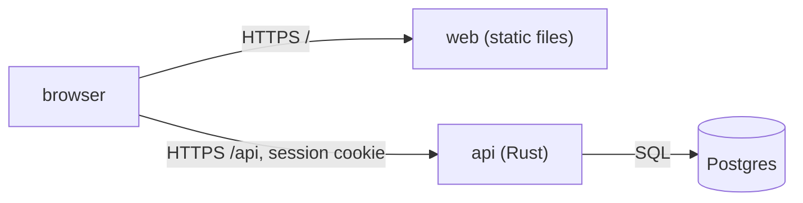

# 0001. Split CineList into a Rust API and a static web front on one origin

- **Status**: accepted
- **Date**: 2026-09-27

## Context

CineList replaces a shared phone note: a handful of friends keep film lists and
eliminate films in turn until one is left. It runs on a Kubernetes cluster and
is used mostly from phones, by people who are sitting next to each other. It
needs accounts, a small relational model and a web interface that works on a
phone. The team maintains Rust and TypeScript code and wants two deployables
it can release and scale separately.

## Decision

We build two components:

- `api`, a Rust HTTP server (axum) that owns every rule of the game and all
  access to the database, and serves its OpenAPI document;
- `web`, a React single-page application compiled to static files and served
  by a static file server, with no server-side logic.

Both are published under **one origin**: the route sends `/api` to the API and
everything else to the front. The front calls the API with relative URLs and a
session cookie.

## Consequences

- The session is a plain `HttpOnly` cookie with `SameSite=Lax`: no CORS, no
  token handling in the browser, and cross-site requests carry no credentials.
- The API mounts every route under `/api`, including its OpenAPI document and
  Scalar reference, so that a path-prefix route works with any Ingress
  controller or Gateway without rewriting paths.
- The front has no server to render or proxy anything: every piece of data
  comes from the API, and a slow API is a slow page.
- Two images, two release artefacts, one version number cut together.
- The game rules live only in the API; the front mirrors the size rule to
  guide input, and the API remains the authority.

## Alternatives considered

- **One binary serving both the API and the front**: one image fewer, but the
  front could no longer be released or scaled on its own, and the Rust build
  would have to embed the Node toolchain's output.
- **A Node back-end for the front (BFF)**: a second server holding logic and a
  second network hop, for a front that only needs files served.
- **Two origins with CORS**: cross-site cookies and preflight requests to get
  right, for no benefit to a single-site application.
