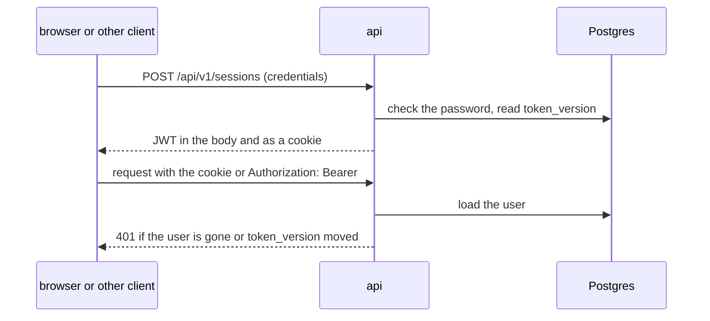

# 0003. Authenticate with long-lived JWTs, from a cookie or a bearer header

- **Status**: accepted
- **Date**: 2026-09-27

## Context

The web front and the API share one origin
([ADR 0001](0001-split-cinelist-into-a-rust-api-and-a-static-web-front.md)),
so a cookie is enough for the browser. The API must also be callable by
clients other than the browser, which send credentials in an `Authorization`
header, and the team wants the widely used JWT format rather than a
home-grown session scheme. Some features depend on cutting a user's access at
once: resetting a password (by accepting a new invitation) and deleting an
account.

## Decision

Signing in, or accepting an invitation, issues a JWT signed with HS256 and a
secret from the configuration (`JWT_SECRET`), valid for a fixed number of days
(`TOKEN_TTL_DAYS`, 30 by default) and not extended by use. The API returns it
in the response body and sets it as an `HttpOnly`, `SameSite=Lax` cookie; it
accepts it from either the `Authorization: Bearer` header or that cookie.
Nothing about the token is stored.

The token carries the user's id and a per-user `token_version`. Every request
loads the user and rejects the token when the user no longer exists or the
versions differ. Accepting an invitation increments the version.

## Consequences

- One token format for every client, and no session table to write to on
  sign-in or to purge.
- A password reset and an account deletion take effect at once, at the cost
  of one indexed user lookup per request, which the handlers need anyway.
- A single token cannot be revoked: signing out clears the cookie, but a copy
  of the token keeps working until it expires. Only moving the user's
  `token_version` or rotating `JWT_SECRET` (which signs everyone out) stops it.
- A session lasts at most `TOKEN_TTL_DAYS` from sign-in, however active the
  user is; then they sign in again.
- `JWT_SECRET` is one more secret to provision and keep private; anyone
  holding it can mint tokens for any user.
- The token is returned in the sign-in response body, so the page's
  JavaScript can read it at that moment even though the front only relies on
  the cookie.

## Alternatives considered

- **Opaque session tokens stored in the database**: every token revocable one
  by one, but a non-standard format for API clients and a table to maintain.
- **Short-lived access JWT plus a refresh token stored in the database**:
  revocable within minutes, but a refresh flow in every client and the
  session table back under another name.
- **A JWT in `localStorage` only**: no cookie, but the token is readable by
  any script injected into the page.
